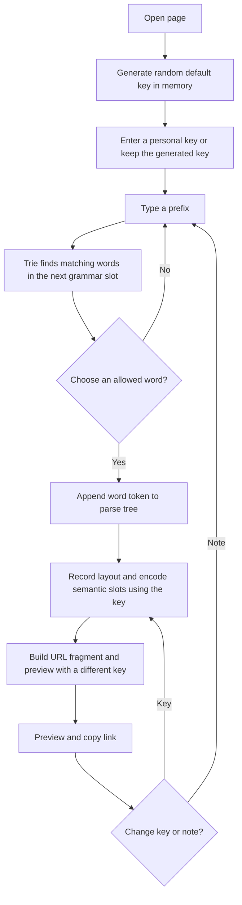
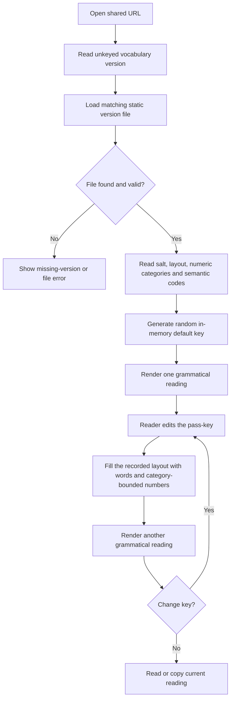

# Functional design

## Purpose and scope

A writer composes a note using a controlled English vocabulary and grammar. The page continuously creates a shareable URL. A reader opening that URL sees one grammatical reading generated by a random default key. Every entered pass-key produces a complete note that the composer could produce with that vocabulary version. Keys change the words and numeric values within the stored layout and number categories; the writer's key reproduces the note they selected. The page never identifies a key as correct or incorrect. Everything in the core flow runs in the browser; there is no account, database, or note API.

This document describes the intended interface. The implemented codec stores the recursive layout in the payload, keeps numeric categories fixed, and chains semantic results into subsequent lookups. See [stored layout and numeric categories](layout-payload-design.md). The browser demo exercises this codec; the complete constrained composer is still planned.

## Page wireframe

```text
Desktop / wide screen                       Narrow screen: same panels stacked
┌──────────────────────────────────────────────────────────────────────────┐
│ PakuPaku                                       Compose   Read   About     │
├──────────────────────────────────────────────────────────────────────────┤
│ Secret key                                                               │
│ [••••••••••••••••••••••••••••••••••••] [Show] [Generate]                 │
│ Minimum 3 characters. A generated key is selected by default.          │
│ Share the key separately from the link.                                  │
├────────────────────────────────────┬─────────────────────────────────────┤
│ Your note                          │ Reader preview                      │
│ [i] [saw] [her] ...                 │ washington served pudding.          │
│ [Type to find the next word      ] │ Key-dependent reading               │
│ Bad token shown red in the draft    │                                     │
│ Allowed next: adjective or noun    │                                     │
│ [Undo word] [Finish note]          │                                     │
├────────────────────────────────────┴─────────────────────────────────────┤
│ Shareable link                                                           │
│ [https://name.github.io/pakupaku/#p=...]                    [Copy link]  │
│ The link updates after each accepted word or key change.                │
└──────────────────────────────────────────────────────────────────────────┘

Reader view opened from a link:
┌──────────────────────────────────────────────────────────────────────────┐
│ PakuPaku                                                   Compose       │
│ washington served pudding                                                │
│ Secret key [••••••••••••••••••••••••••••••••] [Show] [Render]           │
│ Every pass-key produces a complete reading.                              │
│ [Copy note] [Start a new note]                                            │
└──────────────────────────────────────────────────────────────────────────┘
```

The note editor automatically lowercases typed letters. It marks the first impossible token in red and explains the problem beside the field. An unfinished but still possible word is left unmarked. Spaces and line breaks are accepted while typing and are normalized in the created link. The key field is a real password input. The interface should be keyboard accessible: typing filters suggestions, arrows move through them, Enter accepts one, Escape closes the list. A click or tap also accepts a suggestion. A screen-reader announcement states the allowed category and suggestion count.

## Writer flow



The key may be changed at any time during composition. The selected words in the editor stay fixed; the generated link and preview change as the key changes. This avoids silently replacing a writer's words. Changes to the note or key replace the current draft URL in browser history rather than adding a history entry per keystroke. A URL is shareable only after the note reaches a valid completion point. At that point the writer can finish or continue with a grammatical conjunction; there is no fixed word-count cutoff.

## Reader flow



The reader's generated default key is almost certain to differ from the writer's, but collisions in the rendered sentence are possible. The writer can share their key separately if they want the reader to see the selected reading. The app makes no claim that one reading is the original. Every reader pass-key produces a complete reading. Link and vocabulary-file errors are determined before interpreting the key and do not change when the key changes.

## Product rules

1. The composer retains the original minimum of three Unicode characters when creating a shareable note. Key whitespace remains significant and is never trimmed. The reader accepts every input string, including shorter or empty input, and always renders a complete reading. A long random default key is generated in memory. Keys are never saved in the URL, local storage, session storage, cookies, analytics, or server requests.
2. A note is a sequence of selected vocabulary entries and numeric tokens. Prefix typing finds words, which must be accepted from the legal suggestions. Where the grammar allows `#`, the writer can type and commit a whole number in the supported range. Subject pronouns such as `i` and `she` occupy subject positions; object pronouns such as `me` and `her` occupy object positions. `you` and `it` can serve in either case.
3. The suggestion list is the intersection of prefix matches from a trie and words legal in the current parse-tree slot. A word may appear in several parts of speech, with the selected sense/role recorded explicitly.
4. The first version renders lowercase words and digit strings with single spaces, periods between utterances, an optional final period, and commas before `and`, between a greeting and addressee, or after an addressee before a statement. The editor lowercases as the user types and normalizes whitespace for the link. Commas within numbers and arbitrary clause separators are outside the current grammar. Greeting, vocative, salutation and day-part slots support `hello`, `hello world`, `hi good morning`, `hello, world`, and `sally, i slept` with key-dependent words and public punctuation. Names are vocabulary entries; numbers use a calculated mapping for `#` slots. Each numeric slot records a public magnitude category; all keys produce a value in that category. Current categories are 0–99, 100–9,999, 10,000–999,999, then one category per decimal digit count. Noun forms follow the rendered number, such as `1 apple` and `23 apples`.
5. The composer updates a compact shareable URL after each accepted word and key change, with sharing available when the note is complete and its writer key meets the authoring minimum. A literal `tinyurl.com` link is not part of the local-only core; a third-party shortener requires an external service and the user's explicit choice to send the full link there.
6. Opening the URL loads its vocabulary version and generates a reading with the random default key. The layout, token count, numeric positions and numeric categories are public and stay fixed for the link. The finite vocabulary and context may still let a person infer the writer's reading.
7. The writer's key reconstructs the selected sentence structure, words, and committed numeric values. Every other pass-key generates a complete composer-supported reading with the same layout and token count, keeping values within their recorded numeric categories. Different keys may also produce the same reading; this is an expected collision, not a verification result.
8. The reader view updates as any pass-key is typed and when **Render** is selected. The button does not check whether a key matches the writer's. One-character, two-character, and empty inputs each get a reading. While computation runs, show a neutral updating state and publish only a completed reading; never show an unfinished derivation or an incorrect-key message.
9. Refreshing the page clears the entered key. A copied link contains an unkeyed vocabulary version, salt, and the syntax layout, numeric category identifiers, and transformed semantic values. The reader loads the matching immutable JSON file. If that file is absent, the page says which version is missing and does not substitute the current vocabulary.
10. The note editor marks impossible tokens in red as the user types; incomplete but possible prefixes remain neutral. It distinguishes a word missing from the vocabulary (for example `foobarbaz`) from a known word in the wrong grammatical position (for example `me` as a subject), and names the expected pronoun case. The final forced-choice composer will guide selection before a token is committed. Rendered words and their inflected forms must come from the selected dictionary and be available through the composer's suggestions in the same grammatical context. Rendered numbers must be acceptable through its numeric input. Grammar markers such as `#`, internal IDs, unknown-word placeholders, and incomplete sentences never appear in the note.

## Scope for the first release

One language (English), one recursive grammar, one published vocabulary version, any finite number of supported coordinated phrases, clauses, or period-separated utterances, integer `#` slots, and static hosting. No accounts, uploads, attachments, arbitrary text, live collaboration, server-side storage, or automatic link shortening.

## Decisions to review

- **Plausibility:** review sample readings and the vocabulary entries. The grammar and candidate-list rules stay fixed across vocabulary releases.
- **Vocabulary and numeric limits:** review name coverage and numeric category behavior before freezing the first release. The grammar and format have no fixed word, clause, or nesting count; report actual browser or transport limitations when encountered. Numbers are calculated rather than listed individually in the JSON.
- **Short links:** confirm whether a compact GitHub Pages URL is sufficient or whether an optional third-party shortener should be added later.
